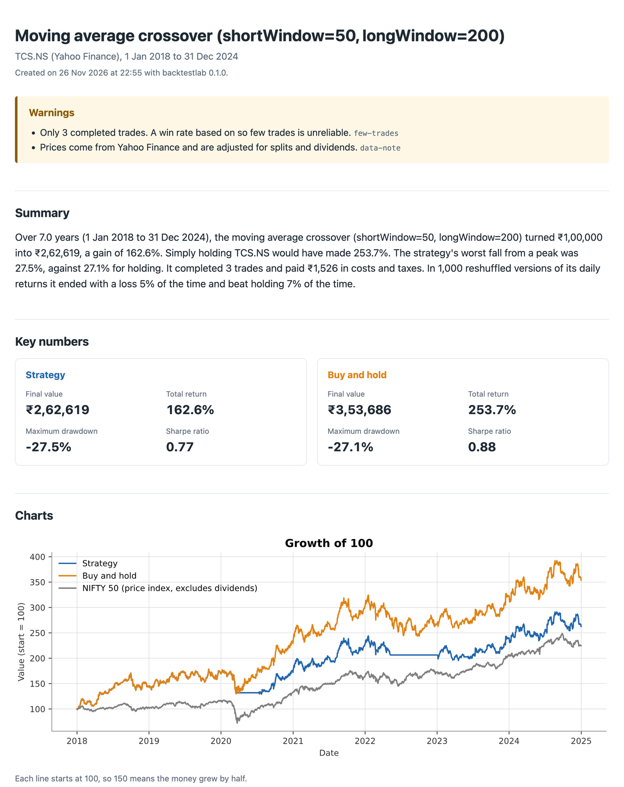

# backtestlab

An honest, India-aware backtester for daily prices, as a small Python library and a command-line tool.

[](https://github.com/mangalvinayak13-vin/backtestlab/actions/workflows/ci.yml)




## Why I built it

I'm a first-year B.Tech student, and when I started testing trading ideas I found that it is very easy to fool yourself. A backtest can quietly use tomorrow's price, forget about brokerage and taxes, or look great only because of a few lucky months. I wanted a tool that makes those mistakes hard to make, and that explains its results in plain words.

- Honest by default. A decision made at a close is only carried out at the next open, so the strategy can't see the future. Costs are always included. Every result is compared with simply holding the same asset over the same days, a Monte Carlo check shows how much the result depends on luck, and plain warnings appear when a result shouldn't be trusted.
- India-aware. The `india` preset has real delivery-trade charges (brokerage, STT, stamp duty, exchange fees, GST and the DP charge), shows money as ₹1,00,000, and compares with NIFTY 50. The `default` preset is market-neutral.
- Beginner-friendly. A strategy is about 10 lines of Python, and the report explains every number.

One command takes prices and a strategy and writes a self-contained HTML report and a JSON results file.

## Install

You need Python 3.12 or newer.

```
pip install git+https://github.com/mangalvinayak13-vin/backtestlab
```

## Quick start

From the command line, with prices from Yahoo Finance:

```
backtestlab run --ticker TCS.NS --strategy ma-crossover --preset india --start 2018-01-01 --end 2024-12-31
```

With a CSV file of your own (columns `date`, `open`, `high`, `low`, `close`, and optionally `volume` and `Adj Close`):

```
backtestlab run --csv data/sampleprices.csv --strategy ma-crossover --param shortWindow=20 --param longWindow=100
```

`data/sampleprices.csv` is synthetic: about five years of made-up prices, generated by `scripts/makesampledata.py`. It is there so you can try everything without a download.

Both commands write `report.html` and `report.json`. `backtestlab strategies` lists the strategies and their parameters, and `backtestlab --help` shows every option.

From Python:

```python
from backtestlab.api import (
    MovingAverageCrossover,
    downloadPrices,
    presets,
    runBacktest,
    writeReport,
)

strategy = MovingAverageCrossover(shortWindow=50, longWindow=200)
prices = downloadPrices("TCS.NS", "2018-01-01", "2024-12-31", historyBars=strategy.warmupBars)
result = runBacktest(prices, strategy, presets.INDIA, start="2018-01-01")
writeReport(result, "report.html")
```

## Writing your own strategy

A strategy is a frozen dataclass with a `decide` method. It receives the price history up to and including today and returns how invested to be tomorrow, from 0 (all cash) to 1 (fully invested).

```python
from dataclasses import dataclass
from typing import ClassVar

import pandas as pd

from backtestlab.api import Strategy, loadCsv, runBacktest, writeReport


@dataclass(frozen=True)
class AboveAverage(Strategy):
    description: ClassVar[str] = "Invested while the close is above its moving average."
    window: int = 100

    @property
    def warmupBars(self) -> int:
        return self.window

    def decide(self, history: pd.DataFrame) -> float:
        closes = history["close"]
        return 1.0 if closes.iloc[-1] > closes.tail(self.window).mean() else 0.0


result = runBacktest(loadCsv("data/sampleprices.csv"), AboveAverage(window=100))
writeReport(result, "report.html")
```

`examples/customstrategy.py` has the full version, and `examples/quickstart.py` runs the built-in crossover on the sample data.

## What's in the report

- Warnings at the top, when there are any.
- A summary in plain words, for example: "Over 7.0 years (1 Jan 2018 to 31 Dec 2024), the moving average crossover (shortWindow=50, longWindow=200) turned ₹1,00,000 into ₹2,62,618, a gain of 162.6%. Simply holding TCS.NS would have made 253.7%."
- Key numbers for the strategy and for buy and hold.
- Charts: growth of 100, drawdown, and the price with every buy and sell marked.
- A metrics table (total and annualised return, volatility, Sharpe ratio, maximum drawdown, time in the market, trades, win rate, costs), with what each number means.
- Robustness: the Monte Carlo fan chart and histogram, percentiles, the chance of a loss, the chance of beating buy and hold, and a table with costs times 0, 1 and 2.
- Every trade, every setting, where the money went, and a disclaimer.

The page has no JavaScript and loads nothing from the internet, so it opens offline and can be sent as one file.

## How it avoids common backtesting mistakes

- Look-ahead: decisions use only the past and are carried out at the next open. Tests change every later price and check that nothing earlier moves.
- Ignoring costs: every trade pays charges and slippage, and cash can never go negative.
- Unfair comparisons: buy and hold runs through the same engine, days, costs and whole-share rule.
- Luck: a paired block-bootstrap Monte Carlo reshuffles the strategy's own daily returns in month-long blocks, 1,000 times.
- Fragile results: the cost table shows what happens when charges double.
- Unadjusted prices and too few trades: both give warnings.

## Presets and costs

`default` has no currency symbol, 100,000 starting cash, 0.1% brokerage per order, 0.05% slippage and whole shares.

`india` is for delivery trades on NSE, with ₹1,00,000 starting cash, whole shares, 0.05% slippage and NIFTY 50 as the benchmark (a price index, so it leaves out dividends).

| Charge | Rate |
|---|---|
| Brokerage | 0.1% per order, capped at ₹20 (a typical discount broker; Zerodha charges ₹0 for delivery) |
| STT | 0.1% on buys and on sells |
| Stamp duty | 0.015% on buys |
| Exchange and SEBI charges | 0.00307% + 0.0001%, on both sides |
| GST | 18% on brokerage, exchange and SEBI charges |
| DP charge | ₹15.34 per sell, GST included |

So a buy worth ₹1,00,000 costs ₹142.34 and a sell of the same size costs ₹142.68. I checked these charges on 23 Nov 2026 against Zerodha's charges page and the Groww and Angel One pricing pages. Brokers differ, so check your own broker's charges.

## Limitations

- Long only (no short selling or borrowing), one asset at a time, daily prices only.
- Adjusted prices are rescaled using later dividends and splits, so a rule based on an exact price level (like "buy below ₹500") behaves differently from how it would have at the time.
- Survivorship bias: testing a company that still exists today makes the past look kinder than it was.
- No tax on gains, idle cash earns nothing, and broker minimum charges and rounding rules are ignored.
- Yahoo Finance data is unofficial. Nothing downloaded from it is stored in this repository.

## Roadmap

For version 2 I want to add:

- running a strategy straight from a GitHub repository;
- a GitHub Action that runs a backtest on every push;
- a signals file (dates and positions), so a model written in any language can be tested.

## Contributing

Issues and pull requests are welcome. Please run the checks before opening a pull request:

```
python -m pip install -e ".[dev]"
python scripts/check.py
```

This runs ruff, mypy in strict mode and pytest with coverage. The project has a few house rules (camelCase names, no underscores anywhere, one-line comments), and `tests/testrules.py` checks them.

## Licence and disclaimer

MIT licence, see `LICENSE`.

backtestlab is for education and research only. It is not investment advice. Past results don't guarantee future results, and real costs, fills and data may differ.
