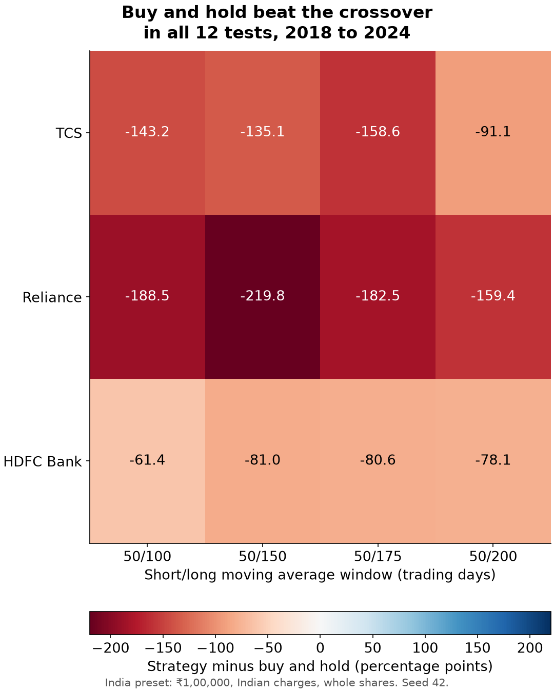
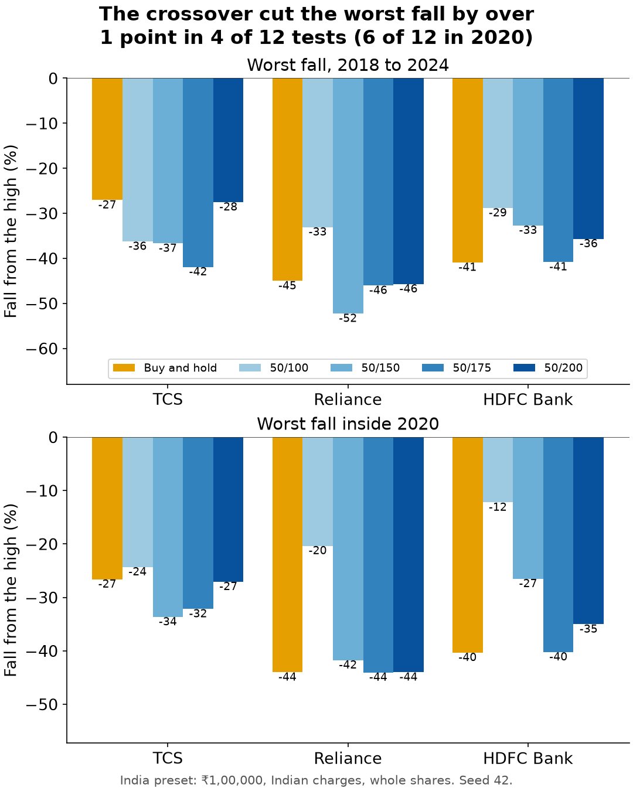
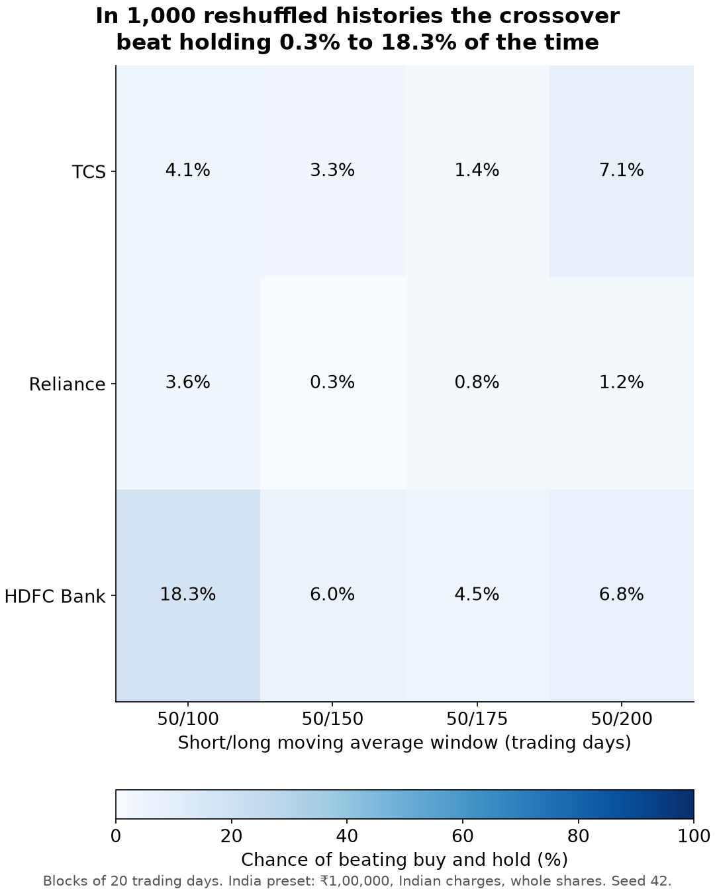
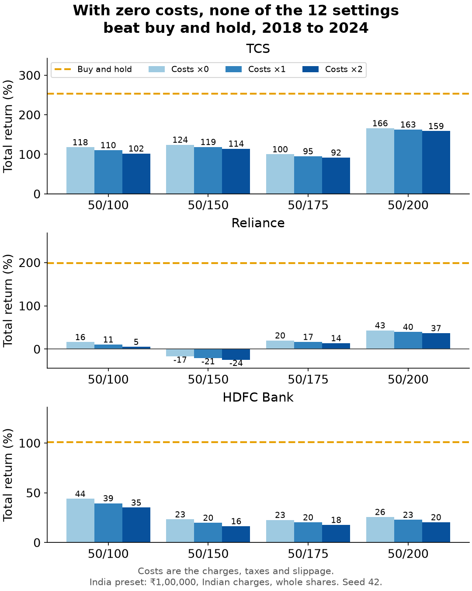
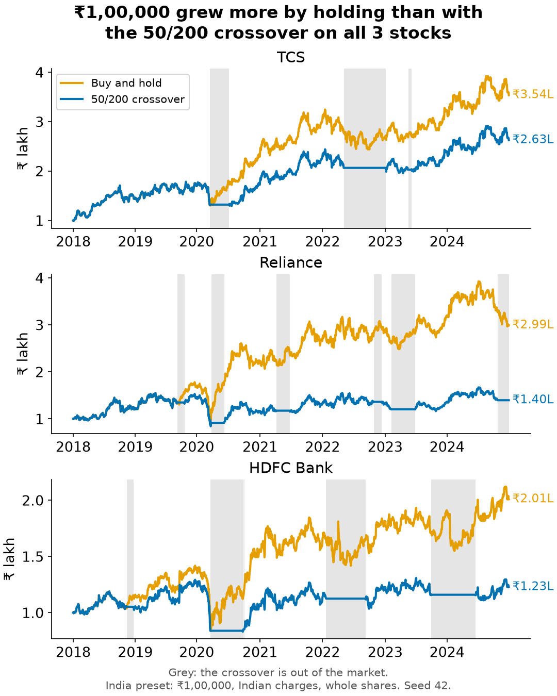
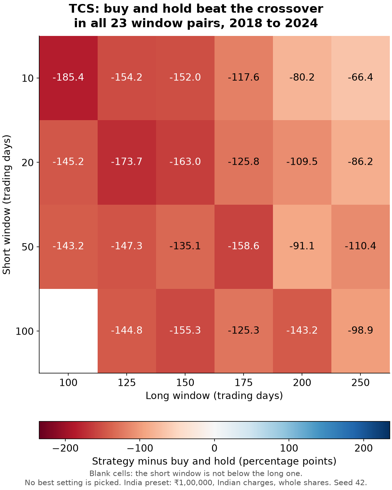
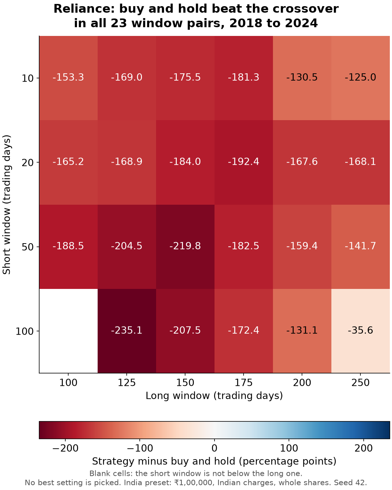
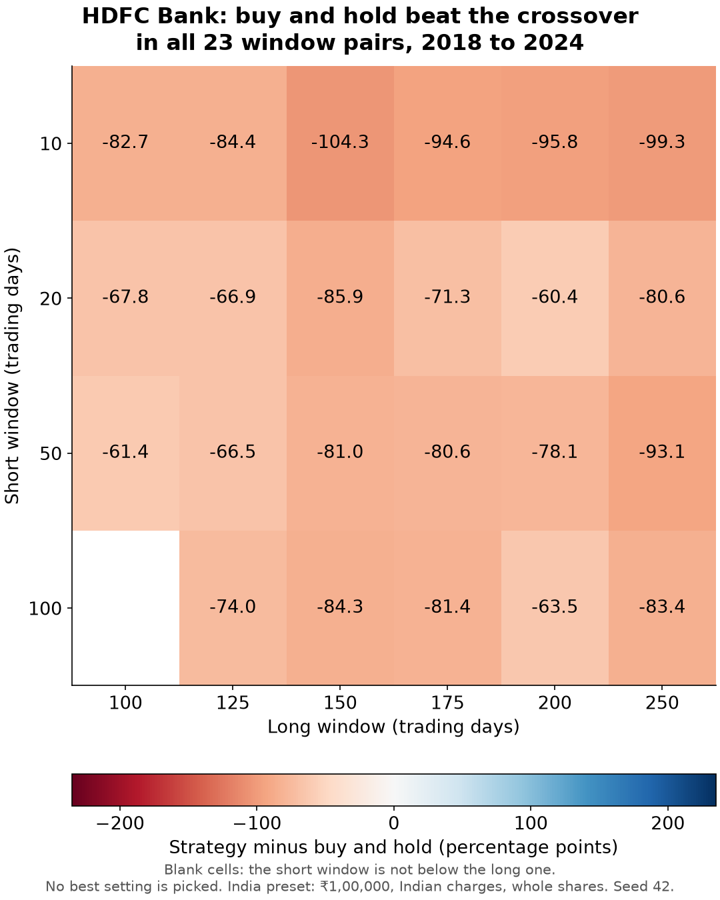
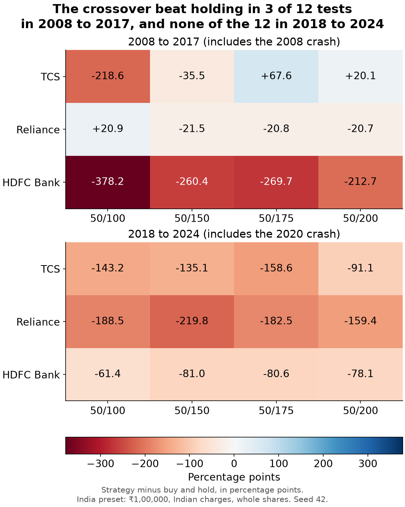

# Does a moving average crossover beat buy and hold once costs and luck are counted?

After my launch post, a reader asked how many of my strategies still beat buy and hold once the charges and the Monte Carlo spread are in. They also suggested comparing the worst fall and the time under water, testing the long window's neighbours, and keeping the same seed. This page is the full breakdown I promised.

The short answer: in the 12 tests I promised (TCS, Reliance and HDFC Bank, a 50-day short window against long windows of 100, 150, 175 and 200 days, 2018 to 2024), buy and hold made more money every timein {{ facts.lost }} of 12. Holding made {{ "%.1f"|format(-facts.gap[1]) }} to {{ "%.1f"|format(-facts.gap[0]) }} percentage points more. In 1,000 reshuffled versions of each test, the crossover finished ahead {{ "%.1f"|format(facts.chance[0]) }}% to {{ "%.1f"|format(facts.chance[1]) }}% of the time.

Everything here comes from one script, [`crossover.py`](crossover.py), which runs [backtestlab](../../README.md) on prices I saved from Yahoo Finance. Every number is also in [`results.csv`](results.csv), one row per backtest.

## Setup

- Strategy: the moving average crossover in backtestlab. It holds the stock while the average close of the last 50 days is above the average close of the last 100, 150, 175 or 200 days, and holds cash otherwise. It decides at the close and trades at the next day's open.
- Stocks: TCS.NS, RELIANCE.NS and HDFCBANK.NS on the NSE.
- Period: 1 Jan 2018 to 31 Dec 2024. Each price file starts in June 2016, so even the longest window has its full history on the first day of the test.
- Settings: backtestlab's `india` preset with nothing changed, except the seed in the seed check and fractional shares for the index in the last check. That means {{ settings.cash }} to start, whole shares only, {{ settings.slippage }} slippage on every trade, {{ settings.simulations }} Monte Carlo runs in blocks of {{ settings.blockLength }} trading days, seed {{ settings.seed }}, and "{{ settings.benchmarkLabel }}" as the market comparison.
- Charges (checked on {{ settings.costsChecked }}):
  - {{ note }}
- Data: daily prices from Yahoo Finance, adjusted for splits and dividends, downloaded once on {{ downloaded }} and saved as CSV files. Every backtest reads those files, so the numbers can be rebuilt exactly. The price files are not in this repository, because Yahoo's terms don't allow sharing its data.

## What each number means

- Total return: the value on the last day divided by {{ settings.cash }}, minus 1.
- Strategy minus hold: the strategy's total return minus buy and hold's, in percentage points. Negative means holding made more.
- Buy and hold: buying the same stock on the second day of the test with the same money, charges and whole-share rule, then never selling.
- NIFTY 50: the index scaled to {{ settings.cash }} on the first day, with no costs. It is a price index, so it leaves out dividends.
- Annualised return: the yearly growth rate that gives the same total return over the test.
- Volatility: how much the daily returns jump around, scaled to a year.
- Sharpe ratio: average daily return divided by how much it jumps around, scaled to a year (with a 0% risk-free rate). Higher is better.
- Worst fall: the biggest drop from a high to a later low, in percent, with the dates of the high and the low.
- Worst fall in 2020: the same, but the high and the low both have to be inside 2020 (inside 2008 for the 2008 to 2017 tests).
- Longest time under water: the longest run of trading days on which the value was below an earlier high. A run that hadn't ended by 31 Dec 2024 still counts and is marked. My first count, which I posted, used calendar days from the high to the day the value got back to it, so both counts are shown.
- Stretch with the 2020 low: the run of trading days below an earlier high that contains the day of the worst 2020 low.
- Time in the market: the share of days on which the strategy held the stock at the close.
- Round trips: completed buy-then-sell pairs. Win rate is the share of round trips that made money after costs.
- Charges and taxes, and slippage: everything paid on all trades, in rupees.
- Chance of beating buy and hold: how often, out of 1,000 reshuffles, the strategy's total return came out higher than holding's (see the Monte Carlo note below).
- Costs ×0, ×1 and ×2: the same strategy run again with every charge, tax and the slippage set to zero, left as they are, and doubled.

## Part 1: the 12 tests I promised



### Returns

{{ tables.returns }}

### Risk and return per year (strategy / buy and hold)

{{ tables.risk }}

### Worst falls



{{ tables.falls }}

### Time under water (trading days)

{{ tables.underwater }}

### Trading and costs

{{ tables.trading }}

### Monte Carlo



{{ tables.monteCarlo }}

The Monte Carlo check in two sentences: it takes the daily returns that the strategy and buy and hold actually earned, cuts them into 20-day blocks and shuffles the same blocks for both, 1,000 times, to see how often the strategy finishes ahead. It doesn't test new prices or new signals, so it shows how much the result depends on the order of these particular days, and it can't say whether the rule will work in the future.

### Costs ×0, ×1 and ×2



{{ tables.costs }}

### Warnings from backtestlab

{{ tables.warnings }}

### Growth of {{ settings.cash }}, 50/200 against buy and hold



### Every 50/200 round trip

{{ tables.trips }}

### 2020: when the 50/200 crossover left the market and when it came back

{{ tables.out }}

"Holding gained in between" is the change in the stock's opening price from the day the strategy sold to the day it bought back. It is what the strategy missed (or avoided, when it is negative) by being in cash.

## What I found

1. Buy and hold won all 12 tests{{ facts.lost }} of 12 tests, by {{ "%.1f"|format(-facts.gap[1]) }} to {{ "%.1f"|format(-facts.gap[0]) }} percentage points. In this strong uptrend the crossover sold after falls and bought back only after prices had recovered. In 2020 the three 50/200 runs sold between {{ exits.sold[0] }} and {{ exits.sold[1] }}, close to the low, and bought back between {{ exits.back[0] }} and {{ exits.back[1] }}. Holding gained {{ "%.1f"|format(exits.gain[0]) }}% to {{ "%.1f"|format(exits.gain[1]) }}% while they waited in cash.
2. Charges are not the reason. With every cost set to zero, none of the 12 settings beat{{ facts.freeWins }} of 12 settings beat buy and hold. Removing all costs added only {{ "%.1f"|format(facts.costEffect[0]) }} to {{ "%.1f"|format(facts.costEffect[1]) }} points to the strategy's return. The loss comes from the timing.
3. The protection on the way down was small and patchy. The crossover's worst fall was more than 1 point smaller than holding's in {{ facts.smallerFalls }} of 12 tests over 2018 to 2024, and in {{ facts.smallerCrashFalls }} of 12 inside 2020. Its longest time under water was longer than holding's in all 12 tests, counted in trading days or in calendar days{{ facts.longerUnder }} of 12 tests counted in trading days, and {{ facts.longerUnderCalendar }} of 12 counted in calendar days. Sitting in cash at a lower value is still time under water.
4. The loss holds across the plateau. Over the wider grid of {{ facts.plateauTried }} short and long windows, none beat{{ facts.plateauWins }} beat buy and hold. Because so many settings were tried, a single winner here could have been luck, so I don't pick a best setting.
5. The older period with the 2008 crash looks different. From 2008 to 2017 the crossover beat holding in {{ facts.olderWins }} of 12 tests and cut the 2008 fall by more than 1 point in {{ facts.olderSmallerCrash }} of 12. The drawdown case is real in a long, deep crash, but it wasn't enough to win most of the time, and the longest time under water was still longer than holding's in {{ facts.olderLongerUnder }} of 12.
6. On a stock that collapsed, the crossover helped. On YES Bank it beat holding in {{ facts.fallenWins }} of 4 tests, but it still lost {{ "%.1f"|format(-facts.fallenReturn[1]) }}% to {{ "%.1f"|format(-facts.fallenReturn[0]) }}% while holding lost {{ "%.1f"|format(-facts.fallenHold) }}%. My three main stocks all did well over these years, which flatters buy and hold.

## Extra checks I added (not part of what I promised)

### 1. Zero costs

This is the "Costs ×0" column in the costs table above. None of the 12 settings{{ facts.freeWins }} of 12 settings beat buy and hold even with no charges, taxes or slippage, so the late entries cause the loss.

### 2. Other seeds

The seed only changes the Monte Carlo draw, never the backtest itself. Across seeds 1 to 5, the chance of beating buy and hold stayed between {{ "%.1f"|format(facts.seed[0]) }}% and {{ "%.1f"|format(facts.seed[1]) }}%, and no test moved by more than {{ "%.1f"|format(facts.seedMove) }} points between seeds. None of the conclusions depend on the seed.

{{ tables.seeds }}

### 3. Interest on idle cash (my assumption, worked out outside backtestlab)

backtestlab pays nothing on cash. To see whether that matters, I took each day's cash balance from the backtest and added interest at 6% a year, compounded daily over 252 trading days. I did the same for buy and hold, which keeps a little cash left over after buying whole shares. This is a rough estimate: in reality the interest would also change how many shares the next buy gets.

{{ tables.idle }}

It narrows the gap but changes none of the 12 resultsIt changes {{ facts.idleFlips }} of the 12 results. In the 2008 to 2017 tests below, the same estimate would turn {{ facts.idleFlipsOlder }} of 12 losses into wins, because the strategy spent long periods in cash.

### 4. A wider plateau of windows

Short windows of 10, 20, 50 and 100 days against long windows of 100, 125, 150, 175, 200 and 250 days, keeping the short one below the long one. That is 23 pairs per stock, so I don't present a best one.







### 5. A period with a long crash: 2008 to 2017

The same 12 tests from 1 Jan 2008 to 31 Dec 2017, with 2008 in place of 2020 for the crash-year columns.



{{ tables.older }}

Time under water, 2008 to 2017:

{{ tables.olderUnderwater }}

### 6. Two more assets: an index fund and a stock that collapsed

I meant to use NIFTYBEES.NS, a NIFTY 50 ETF, but its Yahoo prices are broken around a unit split. backtestlab flagged it: "{{ etfNotes | join(" ") }}" So I used the NIFTY 50 index itself (^NSEI) in its place. The index level was over 10,000, so one whole unit would have used about a tenth of the money. A real ETF unit costs far less, so for this one asset I allowed fractional shares. The index has no price on 1 Jan 2018, so these tests start on 2 Jan 2018. It leaves out dividends, and the charges are the stock charges from the india preset.I used NIFTYBEES.NS, a NIFTY 50 ETF.

I picked YES Bank on purpose, because it collapsed in 2020 and shows the other side: my three main stocks all did well, and testing only stocks that did well (survivorship bias) makes buy and hold look better than it would have looked at the time. YES Bank's big one-day moves in March 2020 are real (a bank rescue), and backtestlab warns about them because moves that size are usually data errors.

{{ tables.assets }}

## Checks on the numbers

For the 50/200 test on each stock I worked out three numbers again without the engine: the buy and hold return from the opening and closing prices and the charge formula, the number of times the 50-day average crossed above the 200-day one (with pandas' own rolling averages), and the worst fall straight from the equity curve. All of them match backtestlab.Not all of them match, see the table.

{{ tables.checks }}

The 50/200 numbers also match what I wrote before:

{{ tables.earlier }}

I ran the script twice and `results.csv` came out identical both times.

## Limitations

- The 12 promised tests have only {{ facts.trips[0]|int }} to {{ facts.trips[1]|int }} round trips each, so the win rates in particular mean very little. backtestlab warns about this in every test.
- Survivorship bias: TCS, Reliance and HDFC Bank are big, successful companies today. I picked them knowing that, and the YES Bank check shows how different a failed stock looks.
- The NIFTY 50 comparison uses the price index, which leaves out dividends (roughly 1% to 1.5% a year), so it makes the index look worse than a real index fund. Buy and hold of each stock does include dividends, because Yahoo's prices are adjusted for them.
- Yahoo Finance data is unofficial and can be revised. My numbers match my earlier run, but a later download could differ slightly.
- Long only, one stock at a time, daily prices, no tax on gains and no interest on cash (except in the estimate above).
- Past results don't predict future ones. This is for education only and is not investment advice.

## Rebuild everything

```
python -m pip install -e ".[dev]"
python experiments/crossover/crossover.py download
python experiments/crossover/crossover.py run
```

The first command after the install downloads the prices (once). The second runs all {{ runCount }} backtests from the saved files and rewrites `results.csv`, the charts and this page. It takes about two minutes.
